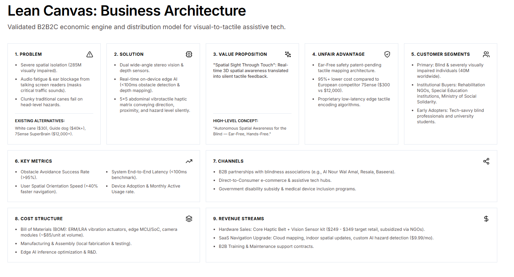

# Ally Vision — Official Business Model Canvas (BMC)

> **Project:** Ally Vision (Assistive DeepTech Hardware & Spatial AI Startup)  
> **Institution:** Egyptian-Chinese University (ECU) — Faculty of Engineering & Technology  
> **Target Market:** 285M Visually Impaired Worldwide (40M+ MENA, 1.5M Egypt)  
> **Benchmark Global Competitor:** 7Sense (SuperBrain — Estonia, retail price $4,000+)  
> **Official Repository:** [https://github.com/abdallared/GraduationProject](https://github.com/abdallared/GraduationProject)  
> **Direct PDF Download:** [Download BMC.pdf](./BMC.pdf)

---

## 1. Visual Business Model Canvas (All 9 Blocks)

---

## 2. Comprehensive 9-Block Lean Canvas Specification

| 1. Problem | 4. Solution | 3. Unique Value Proposition | 9. Unfair Advantage | 2. Customer Segments |
| :--- | :--- | :--- | :--- | :--- |
| **Core Critical Pain Points:** 1. **Loss of Navigational Autonomy:** Fear of collisions with overhead/dynamic hazards; heavy reliance on human guides. 2. **Failure of Existing Tools:** • White canes miss chest/head-level hazards (frequent injuries). • Audio glasses mask vital ambient street sound, creating traffic hazards. • European alternatives (7Sense, BrainPort) cost $3,000–$5,000+, out of reach for emerging markets. 3. **Rugged Terrains:** Broken sidewalks requiring real-time safe corridor extraction.  **Existing Alternatives:** White cane, guide dogs, audio smart glasses (OrCam), 7Sense (Europe). | **Integrated 3-Stage System:** 1. **Wearable Sensor Headset:** High-efficiency RGB-D depth camera capturing 3D spatial points at 30 FPS. 2. **Edge AI Safe Corridor Engine:** RANSAC 3D ground plane extraction determining clear path angles (80 cm clearance envelope). 3. **$5 \times 5$ Forehead Tactile Matrix:** 25 micro-actuators with physical height profiles (0 to 5) translating distance into intuitive touch without sensory numbness. | **"A physical sixth sense delivering navigational independence without blocking hearing, at a fraction of global competitor costs."**  **High-Level Concept:** *"7Sense reimagined with true physical height-profile feedback, optimized for rugged real-world environments and emerging market affordability."* | 1. **Proprietary Spatial Algorithm IP:** Real-time RANSAC Safe Corridor extraction paired with low-latency pin height encoding. 2. **True Physical Pin Feedback:** Displacement heights (0 to 5 mm) instead of surface vibrations, eliminating sensory fatigue and numbness. 3. **Frugal Hardware Architecture:** Bill of Materials (BOM) engineered at <20% of European competitor costs. | **Target Segments:** • **End-Users (B2C):** Blind and visually impaired individuals seeking independent mobility for university and employment. • **Institutional Buyers (B2B / B2G):** Blind welfare NGOs, rehabilitation centers, specialized schools, and public healthcare. • **Corporate CSR Donors:** Banks and telecom corporations funding assistive tech programs.  **Early Adopters:** Visually impaired university students and active members of Egyptian blind associations. |
| **8. Key Metrics** | | | | **5. Channels** |
| • **End-to-End Latency:** < 100 ms between camera capture and pin motion. • **Obstacle Avoidance Rate:** > 90% collision avoidance in real-world testing. • **User Adaptation Speed:** Intuitive pattern comprehension within 3 to 5 training hours. • **Unit Production Cost:** BOM < $120 / Retail target < $400. | | | | 1. **Direct Institutional Partnerships:** Collaboration protocols with leading blind welfare organizations and rehabilitation hubs. 2. **Digital Platform:** The official [Ally Vision Web Platform](../website) for pre-orders and live demonstration bookings. 3. **Innovation Competitions & Grants:** Accelerators and DeepTech/Social Impact hackathons (TIEC, ITIDA, Flat6Labs). |

---

## 3. Financial Viability & Revenue Logic

### 3.1 Cost Structure (Expenditures)
* **Bill of Materials (BOM) per Unit (~$95 – $120):**
  * RGB-D Depth Camera Module (Wide-angle, 30 FPS): ~$35
  * $5 \times 5$ Micro-Linear Actuator / Stepper Array: ~$45
  * Processing Board & Custom Multi-layer PCB: ~$15
  * Ergonomic 3D-Printed Visor Housing, Straps & Lithium Battery: ~$15
* **R&D and Continuous Engineering:** Edge AI ONNX optimization, firmware maintenance, and ergonomic iteration.
* **Clinical Onboarding & User Training:** 3-to-5 hour structured tactile adaptation workshops.
* **Warranty & Logistics:** 1-year hardware replacement and maintenance reserves.

### 3.2 Revenue Streams (Monetization Engine)
1. **Institutional Procurement (B2B / B2G — 60% of Volume):** Bulk contracts with blind welfare foundations, governmental rehabilitation authorities, and inclusive universities at subsidized pricing ($280 – $320 / unit).
2. **Corporate CSR Sponsorships (25% of Volume):** Commercial partnerships with banks and telecom operators funding batches of 50–200 devices under corporate social responsibility mandates.
3. **Direct Commercial Sales (B2C — 15% of Volume):** Retail sales to capable individuals and private medical insurance schemes at competitive pricing (< $400 / unit vs. $4,000+ competitors).
4. **Hardware-as-a-Service (HaaS) Maintenance Subscription:** Optional annual maintenance plan ($30 / year) covering mechanical pin replacements, accidental damage warranty, and over-the-air AI feature updates.
5. **Non-Dilutive Innovation Grants:** Seed financing from ITIDA, TIEC Start-IT, and international assistive deeptech grants.

---

## 4. Verification & Validation Documents

* **Pitch Deck Presentation:** [`Business Model/ally_vision_pitch_deck.md`](../Business%20Model/ally_vision_pitch_deck.md)
* **Technical System Documentation:** [`AI/Ally_Vision_Documentation.md`](../AI/Ally_Vision_Documentation.md)
* **Interactive Proof of Concept Showcase:** [`Proof_of_Concept/index.html`](../Proof_of_Concept/index.html)

---

*Ally Vision — Business Model Canvas finalized for Investor & Competition Review.*  
*Egyptian-Chinese University (ECU) // 2026*
